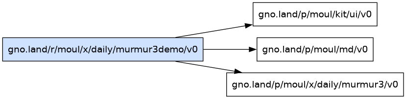

# `gno.land/r/moul/x/daily/murmur3demo/v0`

**Demo of the [`p/moul/x/daily/murmur3`](https://github.com/moul/gno-contracts/tree/main/p/moul/x/daily/murmur3)
library.** No hashing logic of its own, no state, so `Render` is deterministic.

Three things on the page:

- **Vectors.** Six inputs under seed 0 and seed 1. Two of them differ by one
  letter and their hashes differ in 18 of 32 bits, which is the avalanche.
- **Self-test.** The SMHasher verification value, `b0f57ee3`, recomputed on
  chain on every page load rather than quoted from a table.
- **Spread.** A thousand keys over eight buckets, as a bar chart. A hash worth
  using fills all of them.

`Render("/<text>")` hashes whatever you append, under both seeds, with its
shard. The text is echoed inside a fenced code span and never reaches a table
cell, which `escape_test.gno` pins.

> ⚠️ **Not a cryptographic hash.** Anyone who picks the keys picks the bucket.

<!-- BEGIN GNOCONTRACTS FOOTER (generated by `make readmes`; do not edit below) -->

---

Part of **[moul/gno-contracts](https://github.com/moul/gno-contracts)** — moul's versioned gno.land contracts. See the repository for the full catalog, build/test tooling, and usage.

**On mainnet:**    

**Dependency graph:**

> 🧪 **Highly experimental — potentially vibe-coded.** Not audited; may break, change, or be removed at any time. Do not use with anything of value. Full disclaimer: [DISCLAIMER](https://github.com/moul/gno-contracts/blob/main/DISCLAIMER.md).

<!-- END GNOCONTRACTS FOOTER -->
