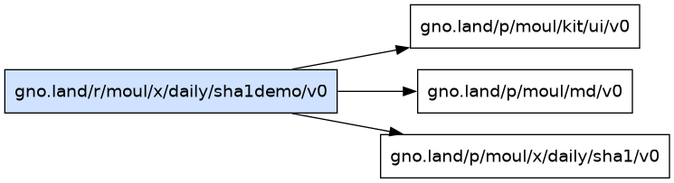

# SHA-1

> ⚠️ **Experimental, generated with no human supervision** by the daily pipeline to exercise gno tooling. Not audited. See [r/moul/x/daily](https://github.com/moul/gno-contracts/blob/main/r/moul/x/daily/README.md).

---

Shows the published SHA-1 vectors, the git object ids anyone can check from a
terminal, HMAC answers starting with RFC 2202 test case 2, and hashes whatever
you put in the path, slashes and spaces included.

```
/r/moul/x/daily/sha1demo/v0        → the vector tables
/r/moul/x/daily/sha1demo/v0:abc    → hash your own text
```

Demo of the [`p/moul/x/daily/sha1`](https://github.com/moul/gno-contracts/tree/main/p/moul/x/daily/sha1)
library, with no hashing logic of its own. Stateless, so `Render` is
deterministic and the pinned example doubles as a conformance test: a wrong
digit anywhere in the library fails it.

The git rows are the ones worth checking by hand. `printf 'hello world\n' |
git hash-object --stdin` prints the same `3b18e512...` the page does, because
git names a blob by the SHA-1 of `blob <len>\x00<content>` rather than of the
content.

SHA-1 is broken for collisions and the page says so: it is here for the formats
that specify it, not as something to protect anything with.

Built for gno 0.9.

<!-- BEGIN GNOCONTRACTS FOOTER (generated by `make readmes`; do not edit below) -->

---

Part of **[moul/gno-contracts](https://github.com/moul/gno-contracts)** — moul's versioned gno.land contracts. See the repository for the full catalog, build/test tooling, and usage.

**On mainnet:** [](https://gnoscope.com/realm/r/moul/x/daily/sha1demo/v0) [](https://gnoscope.com/realm/r/moul/x/daily/sha1demo/v0) [](https://gnoscope.com/realm/r/moul/x/daily/sha1demo/v0) [](https://gnoscope.com/realm/r/moul/x/daily/sha1demo/v0)

**Dependency graph:**



> 🧪 **Highly experimental — potentially vibe-coded.** Not audited; may break, change, or be removed at any time. Do not use with anything of value. Full disclaimer: [DISCLAIMER](https://github.com/moul/gno-contracts/blob/main/DISCLAIMER.md).

<!-- END GNOCONTRACTS FOOTER -->
